# 📘 REGLAS DE NEGOCIO Y ESPECIFICACIÓN ARQUITECTÓNICA DEL SISTEMA DE GESTIÓN DOCUMENTAL INSTITUCIONAL
## UNIÓN PARA LA SALUD Y LA VIDA S.A.S.
### Documento Maestro de Fuente Única de Verdad (SSOT - Single Source of Truth)

---

## 📋 Ficha Técnica del Documento

| Atributo | Detalle Técnico |
| :--- | :--- |
| **Organización:** | Unión para la salud y la vida S.A.S. |
| **Sistema:** | Sistema de Gestión Documental y Calidad Institucional (SGC) |
| **Versión:** | 2.1.0 (Consolidación Oficial de Reglas, Tablas y Diagramas) |
| **Fecha:** | Septiembre 2026 |
| **Carácter:** | **Normativo, Estricto y Vinculante (Fuente Única de Verdad - SSOT)** |
| **Pila:** | SPA Vanilla JS (ES6), CSS3 Puro, Python COM, Apps Script, SharePoint/OneDrive, GHA |
| **Repositorio:** | `gesisusv/repo-doc-sharepoint` |
| **Producción:** | GitHub Pages (`https://gesisusv.github.io/repo-doc-sharepoint/`) |
| **Visor Web:** | Portal interactivo complementario disponible en `reglas_de_negocio.html` |

---

## 📑 Tabla de Contenido

1. [Declaración de Principios y Gobernanza Vinculante](#1-declaración-de-principios-y-gobernanza-vinculante)
2. [Topología y Arquitectura Serverless Híbrida](#2-topología-y-arquitectura-serverless-híbrida)
   - 2.1. Diagrama de Arquitectura del Ecosistema
   - 2.2. Diagrama de Cascada de Prioridad en la Adquisición de Datos
   - 2.3. Matriz de Capas de Persistencia y Tiempos de Respuesta
3. [Inventario Canónico de Archivos y Persistencia de Datos](#3-inventario-canónico-de-archivos-y-persistencia-de-datos)
4. [Jerarquía Documental: Documentos Base vs. Registros Derivados](#4-jerarquía-documental-documentos-base-vs-registros-derivados)
   - 4.1. Diagrama de Relación Jerárquica Padre-Hijo
   - 4.2. Matriz Comparativa: Documento Base vs. Registro Derivado
   - 4.3. Reglas de Integridad Estricta y Desvinculación de URLs
5. [Gestión de Identidad, Perfiles y Matriz de Acceso (RBAC)](#5-gestión-de-identidad-perfiles-y-matriz-de-acceso-rbac)
   - 5.1. Diagrama de Jerarquía de Perfiles
   - 5.2. Diagrama de Flujo de Autenticación y Asignación de Perfil
   - 5.3. Matriz de Mapeo de Cargos y Regla de Saneamiento Directivo
   - 5.4. Matriz Exhaustiva de Capacidades por Perfil (RBAC)
   - 5.5. Persistencia Continua de Sesión en Caché (Sesión Activa Persistente)
6. [Motor de Salida y Matriz Determinística de Descarga](#6-motor-de-salida-y-matriz-determinística-de-descarga)
   - 6.1. Árbol de Decisión Determinística de Descarga
   - 6.2. Matriz de Prefijos Oficiales y Formatos de Salida
   - 6.3. Matriz de Casos Especiales y Manejo de Extensiones
7. [Experiencia de Usuario (UI/UX), Modos de Operación y Filtros](#7-experiencia-de-usuario-uiux-modos-de-operación-y-filtros)
   - 7.1. Diagrama de Estados: Modo Consulta vs. Modo Edición
   - 7.2. Diagrama de Flujo de Filtros en Cascada y Búsqueda NFD
   - 7.3. Matriz de Controles de Interfaz según Modo y Perfil
8. [Telemetría, Auditoría Inmutable y Trazabilidad](#8-telemetría-auditoría-inmutable-y-trazabilidad)
   - 8.1. Diagrama de Ingesta y Filtrado Anti-Flood de Telemetría
   - 8.2. Reglas de Negocio sobre Movimientos y Descargas en Google Sheets
9. [Procesos Asíncronos, Respaldo y Automatización](#9-procesos-asíncronos-respaldo-y-automatización)
   - 9.1. Diagrama de Secuencia de Respaldo Diario Automatizado (GitHub Actions)
   - 9.2. Diagrama de Concurrencia y Sincronización Cloud con LockService
   - 9.3. Matriz de Políticas de Respaldo y Retención
10. [Políticas Oficiales de Seguridad y Decisiones de Negocio](#10-políticas-oficiales-de-seguridad-y-decisiones-de-negocio)
    - 10.1. Arquitectura de Autenticación Local con SSO de Navegador
      - *Diagrama 10.1.1: Flujo de Autenticación Local y Acceso Federado M365*
      - *Tabla 10.1.1: Comparativa Modelo Local Oficial vs. Modelo MSAL Deprecado*
    - 10.2. Política de Mínimo Privilegio y Denegación por Defecto (Default Deny)
      - *Diagrama 10.2.1: Árbol Lógico de Evaluación de Permisos en Hoja de Cálculo*
      - *Tabla 10.2.1: Tabla de Verdad y Visibilidad según Celda y Perfil*
    - 10.3. Prohibición de Borrado Físico y Retiro Lógico (Soft-Delete)
      - *Diagrama 10.3.1: Ciclo de Vida Documental y Retiro Lógico*
      - *Tabla 10.3.1: Matriz Diferencial: Retiro Lógico vs. Borrado Físico Prohibido*
    - 10.4. Tasa Límite (Rate Limiting) y Bloqueo Escalonado
      - *Diagrama 10.4.1: Flujo de Bloqueo Escalonado por Intentos Fallidos*
      - *Tabla 10.4.1: Matriz de Estados de Seguridad y Reglas de Desbloqueo*
11. [Decálogo de Gobernanza para Desarrolladores](#11-decálogo-de-gobernanza-para-desarrolladores)
    - 11.1. Tabla Maestra de Mandamientos Técnicos y Sanción por Violación
    - 11.2. Resumen Nemotécnico para el Desarrollador
12. [Reglas de Negocio del Dashboard y Analítica Institucional](#12-reglas-de-negocio-del-dashboard-y-analítica-institucional)
    - 12.1. Arquitectura de Módulos del Dashboard y Matriz de Acceso RBAC
    - 12.2. Políticas de Gestión de Calidad y Semáforo Quinquenal de Vigencias
    - 12.3. Políticas de Auditoría Institucional y Trazabilidad Transaccional
    - 12.4. Políticas de Control de Cambios Documentales (Histórico Oficial)
    - 12.5. Políticas de Exportaciones Oficiales e Interoperabilidad (CSV / Excel)

---

## 1. Declaración de Principios y Gobernanza Vinculante

### 1.1. Propósito y Carácter Obligatorio
El presente documento constituye la **Fuente Única de Verdad (Single Source of Truth - SSOT)** que rige la totalidad de la lógica de software, flujos de integración, restricciones de seguridad y diseño de interfaz del **Sistema de Gestión Documental Institucional** de **Unión para la salud y la vida S.A.S.**

> [!IMPORTANT]
> **Carácter Vinculante:** Ningún desarrollo presente o futuro, mantenimiento, refactorización o corrección puede desviarse de los lineamientos consagrados en este documento. Toda modificación al código fuente debe preservar estrictamente estas reglas.

### 1.2. Principios Rectores de la Solución

```
┌────────────────────────────────────────────────────────────────────────┐
│                   PRINCIPIOS RECTORES DEL SISTEMA                      │
├────────────────────────────────────────────────────────────────────────┤
│ 1. Integridad Documental Absoluta (Activos Regulados de Salud)        │
│ 2. Arquitectura Serverless Híbrida de Alta Disponibilidad              │
│ 3. Rendimiento Ultrarrápido (< 50 ms via Stale-While-Revalidate)       │
│ 4. Mínimo Privilegio y Denegación por Defecto (Default Deny)           │
│ 5. Protección de Datos Personales y Habeas Data                        │
│ 6. Inmutabilidad y Trazabilidad sin Borrado Físico (Soft-Delete)       │
│ 7. Supremacía Cloud (Google Sheets / OneDrive) y Rol de Caché Local      │
└────────────────────────────────────────────────────────────────────────┘
```

1. **Prioridad Absoluta de la Integridad Documental:** Los documentos institucionales son activos regulados en el marco del Sistema de Garantía de Calidad en Salud. Ninguna rutina informática puede sobrescribir, desvincular o corromper el histórico documental.
2. **Arquitectura Serverless Híbrida:** Despliegue cliente estático de alta disponibilidad en **GitHub Pages**, respaldado por sincronización en la nube con **Google Workspace** (Google Sheets, Drive y Apps Script) y enlaces federados a **Microsoft 365** (SharePoint Online / OneDrive).
3. **Resiliencia y Carga Instantánea (*Stale-While-Revalidate*):** La aplicación debe responder inmediatamente al usuario en menos de 50 ms sirviendo datos desde la caché persistente local (`IndexedDB` y `localStorage`), reconciliando las actualizaciones remotas en segundo plano sin bloqueos visuales.
4. **Acceso Inmediato sin Barreras y Privacidad:** Al cargar el sistema dentro del iframe de SharePoint, se inicia automáticamente bajo el perfil **OPERATIVO (`Usuario Operativo`)** sin exigir credenciales ni obstaculizar la consulta de los colaboradores.
5. **Inmutabilidad y No-Repudio en Google Sheets (*Historico_Documentos*):** Todo movimiento de creación, modificación o retiro de documentos se registra de manera inmutable en la hoja de cálculo de Google Sheets **`Historico_Documentos`**, además de actualizar la casilla de fecha y hora de modificación en **`Biblioteca_Documental`**. Las conexiones antiguas a `Historico_Documentos` e `Historico_Documentos_USV.csv` quedan invalidadas y retiradas del sistema.
6. **Supremacía de Google Sheets como Fuente Única de Verdad (SSOT) del Catálogo:** La Hoja de Cálculo de Google (**`Biblioteca_Documental`**, 25 columnas) es el repositorio maestro oficial del catálogo documental. Los campos más cambiantes corresponden a la *Fecha de Modificación* y al contador de *Descargas* (Columna Y), los cuales se actualizan permanentemente con cada evento correspondiente.
7. **Gobernanza de Persistencia Cloud y Sesión Activa Administrativa:**
   - **`Biblioteca_Documental` (Google Sheets):** Catálogo maestro oficial (25 columnas: metadatos, vínculos directos y conteo acumulado de descargas).
   - **`Historico_Documentos` (Google Sheets):** Histórico oficial de movimientos (creaciones, ediciones y bajas).
   - **`usuarios.conf` (Google Drive):** Almacén seguro para usuarios administrativos (hashes SHA-256 de contraseñas, configuraciones y favoritos de administradores).
   - **`maestro.dat` (Google Drive):** Estructura oficial de tablas maestras institucionales.
   - **Sesión Activa Persistente Administrativa:** Una vez autenticado el usuario administrador a través del icono de candado (🔒), la sesión queda activa de forma permanente en la caché del navegador, sin requerir reautenticación en visitas futuras a menos de ser revocado por otro administrador.
   - **Descargas sin Alteración de Modificación:** Cada descarga ejecutada incrementa en $+1$ la columna *Descargas* en `Biblioteca_Documental`. Al no ser una modificación de contenido, las descargas no alteran la fecha de modificación.

---

## 2. Topología y Arquitectura Serverless Híbrida

La solución integra armónicamente componentes de cliente web, microservicios locales de conversión, microservicios en la nube de Google y almacenamiento colaborativo en Microsoft 365.

### 2.1. Diagrama de Arquitectura del Ecosistema

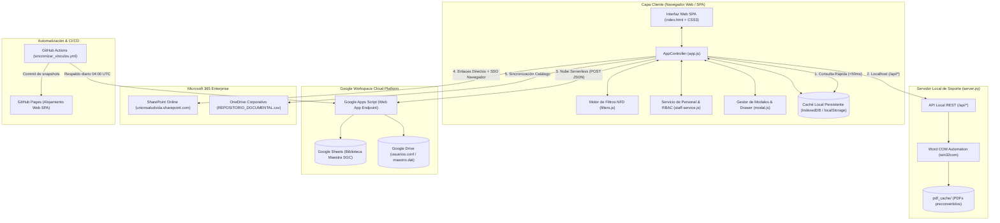

### 2.2. Diagrama de Cascada de Prioridad en la Adquisición de Datos

Para asegurar alta disponibilidad tanto en línea como fuera de línea, la adquisición de datos obedece a la siguiente jerarquía determinística:

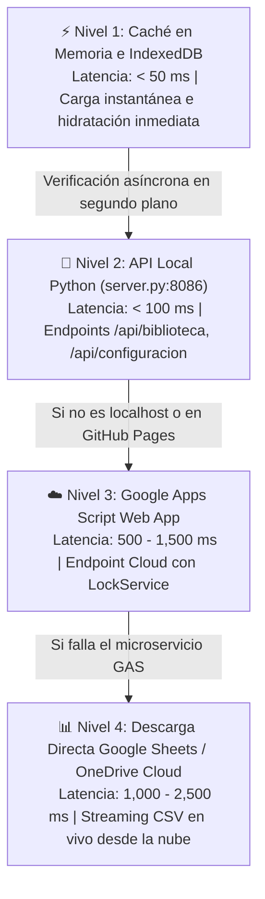

### 2.3. Matriz de Capas de Persistencia y Tiempos de Respuesta

| Nivel | Componente | Protocolo / API | Latencia | Modo Offline | Criterio de Activación |
| :---: | :--- | :--- | :---: | :---: | :--- |
| **Nivel 1** | `IndexedDB` / `localStorage` | Storage API | `< 50 ms` | **100% Offline** | Todo arranque de la SPA. |
| **Nivel 2** | `server.py` (`:8086`) | HTTP REST (`/api/*`) | `50 - 120 ms` | Parcial (Local) | Si `hostname === 'localhost'`. |
| **Nivel 3** | Apps Script Web App | HTTPS POST / JSON | `600 - 1,800 ms` | Requiere Red | En GitHub Pages con conexión. |
| **Nivel 4** | Google Sheets / OneDrive Directo | Fetch HTTP GET | `800 - 2,500 ms` | Requiere Red | Respaldo Cloud directo si falla GAS. |

---

## 3. Inventario Canónico de Archivos y Persistencia de Datos

### 3.1. Matriz Canónica de Componentes del Sistema

| Archivo / Componente | Formato | Ubicación | Función Principal | Regla Operativa Clave |
| :--- | :--- | :--- | :--- | :--- |
| `Biblioteca_Documental` | Google Sheets | Google Drive / Sheets | **Fuente Única de Verdad (SSOT)**. 25 columnas de metadatos, vínculos directos y descargas | Las descargas incrementan celda en $+1$ sin alterar fecha de modificación |
| `Historico_Documentos` | Google Sheets | Google Drive / Sheets | Histórico oficial e inmutable de movimientos (creación, edición y retiro) | Registro auditado con autor, fecha, código y detalle del movimiento |
| `usuarios.conf` | JSON | Google Drive | Almacén de usuarios administrativos, claves SHA-256 y favoritos admin | Persiste credenciales administrativas y sesión en caché de navegador |
| `maestro.dat` | JSON | Google Drive | Estructura oficial de tablas maestras institucionales | Alimenta taxonomía oficial de Tipos de Proceso, Áreas y Procesos |
| `Historico_Documentos_USV.csv` | CSV | *Obsoleto / Retirado* | *Invalidad por nueva arquitectura* | *Eliminado del sistema* |
| `Historico_Documentos` | JSON | *Obsoleto / Retirado* | *Invalidad por nueva arquitectura* | *Eliminado del sistema* |
| `google_drive_backup_script.gs`| GAS (V8) | Apps Script | Microservicio Cloud de mutaciones y lectura de hojas | Manejo atómico de descargas, histórico y usuarios.conf |
| `sincronizar_vinculos.yml` | GHA YAML | `.github/workflows/` | Cruce automatizado OneDrive ↔ Biblioteca_Documental | Detecta variaciones de vínculos y actualiza histórico |
| `server.py` | Python 3 | Raíz Local | API local y servidor de pruebas con proxy CORS | Soporte local con endpoints `/api/*` compactado y optimizado |
| `index.html` | HTML5 | Raíz | Estructura SPA incrustable en iframe de SharePoint | Cero barras de desplazamiento horizontal (`overflow-x: hidden`) |
| `styles.css` | CSS3 | Raíz | Diseño estilizado corporativo responsivo | Adaptación fluida a contenedores iframe y pantallas compactas |
| `js/app.js` | ES6 | `js/` | Controlador principal y gestor de eventos | Coordinador de catálogo, Top 50 y sesión administrativa |
| `js/sharepoint-service.js` | ES6 | `js/` | Servicio de conexión con Google Sheets y OneDrive | Parseo de 25 columnas, registro de descargas e IndexedDB |
| `js/staff-service.js` | ES6 | `js/` | Servicio de seguridad, RBAC y Top 50 | Ranking Top 50 por descargas y autenticación de candado |
| `js/filters.js` | ES6 | `js/` | Motor de filtros relacionales en cascada | Normalización NFD, Top 50 y Favoritos |
| `js/modal.js` | ES6 | `js/` | Modales interactivos, visor y drawer | Formularios de edición para administradores |
| `js/analytics.js` | ES6 | `js/` | Dashboard analítico de calidad | Reservado exclusivamente para Perfil Administrativo |
| `js/cache-service.js` | ES6 | `js/` | IndexedDB Cache | Persistencia local resiliente para carga instantánea |
| `js/data.js` / `js/staff-data.js` | ES6 | *Eliminados* | *Retirados por política de cero datos estáticos en repositorio* | *100% Cloud + Caché IndexedDB en navegador del usuario* |

---

## 4. Jerarquía Documental: Documentos Base vs. Registros Derivados

> **Principio de Universalidad de la Jerarquía Documental:**
> **Cualquier documento del catálogo institucional** (Formatos `FMT`, Procedimientos `PRC`, Instructivos `INS`, Manuales `MN`, Políticas `PT`, Documentos de Apoyo `DA`, etc.) que no sea a su vez un subregistro **puede operar como Documento Base (Padre)** y originar uno o múltiples **Documentos Secundarios o Registros Derivados (Hijos)**.
>
> *(Nota terminológica: El código `FMT-GIC-016` se utiliza en los diagramas de este manual exclusivamente como un **ejemplo ilustrativo de referencia** por ser el primer formato con múltiples registros creados en el sistema. La arquitectura, codificación y reglas de integridad aplican de forma idéntica y universal para cualquier código del catálogo institucional).*

### 4.1. Diagrama de Relación Jerárquica Padre-Hijo (Caso Ilustrativo con FMT-GIC-016)

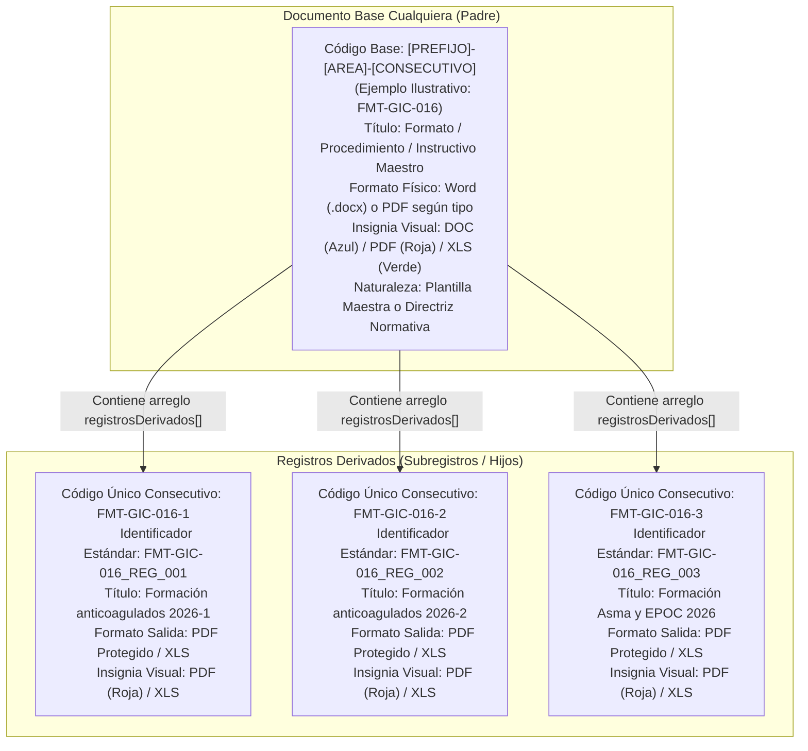

### 4.2. Matriz Comparativa: Documento Base vs. Registro Derivado

| Criterio | Documento Base (Padre) | Registro Derivado (Hijo) |
| :--- | :--- | :--- |
| **Código** | Sin sufijos secuenciales (`FMT-GIC-016`, `PRC-GMD-001`, `INS-GTH-013`). | Con sufijo numérico consecutivo (`-1`, `-2`, `-3`) o propiedad `esRegistro === true`. |
| **Aplicabilidad** | **Cualquier documento** de cualquier macroproceso o área puede ser base. | Derivado de un documento base seleccionado en el modal mediante `nd-select-padre`. |
| **Propósito** | Plantilla en blanco, procedimiento, instructivo o norma general. | Registro operativo diligenciado con información asistencial, técnica o clínica. |
| **Descarga (`📥`)** | **Word (.docx)** en formatos FMT; **PDF** en PRC/INS/MN/PT; **Excel** en XLS. | **OBLIGATORIAMENTE PDF PROTEGIDO** (salvo que el registro sea hoja de cálculo `.xlsx`). |
| **Insignia UI** | `DOC` (Azul) en Word; `PDF` (Roja) en normativos; `XLS` (Verde). | **Siempre `PDF` (Roja)** o `XLS` si es hoja de cálculo; distintivo `📂 REGISTRO DERIVADO`. |
| **Clic en Fila** | Despliega / Oculta el acordeón de subregistros hijos. | Abre Drawer lateral con ficha técnica detallada. |
| **URL de Archivo** | Apunta al archivo maestro en SharePoint Online. | **JAMÁS** hereda URL del padre; requiere archivo propio publicado. |
| **Búsqueda DOM** | Localizado por `doc.codigo`. | Búsqueda dual: `r.id === regId || r.codigo === regId`. |

### 4.3. Reglas de Integridad Estricta y Desvinculación de URLs
- **Vinculación Jerárquica Universal:** Todo subregistro **DEBE** residir dentro del arreglo `base.registrosDerivados[]` de su respectivo documento padre (sin importar el tipo o área del documento padre).
- **Herencia de Metadatos:** Los registros derivados heredan automáticamente Área, Proceso, Tipo de Proceso y Carpeta de su padre.
- **Desvinculación Estricta de Archivos:** Un subregistro **JAMÁS** debe apuntar a la URL del archivo de su padre. Si no cuenta con archivo propio publicado en OneDrive/SharePoint, se marca como `NO DISPONIBLE`.
- **Identificador Único y Resolución Dual:** Todo subregistro posee una propiedad `id` inmutable (ej. `CODIGOPADRE_REG_001` o `FMT-GIC-016_REG_002`) y un código consecutivo único (ej. `FMT-GIC-016-1`). Los botones del DOM emiten `data-reg-id="${reg.id || reg.codigo}"` y los controladores resuelven el elemento mediante búsqueda dual: `r.id === regId || r.codigo === regId`.

---

## 5. Gestión de Identidad, Perfiles y Matriz de Acceso (RBAC)

### 5.1. Diagrama de Jerarquía de Perfiles

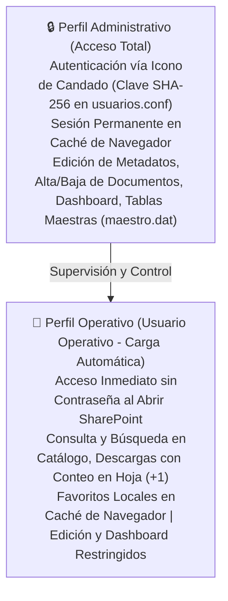

### 5.2. Diagrama de Flujo de Autenticación y Transición de Perfiles

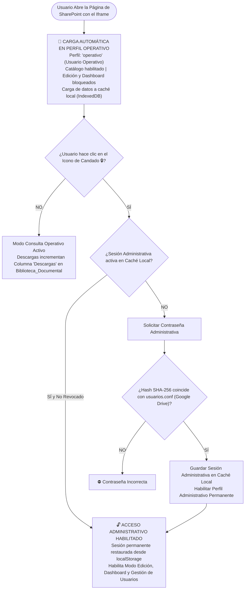

### 5.3. Matriz Exhaustiva de Capacidades por Perfil (RBAC)

| Capacidad / Función | Perfil Operativo (Por Defecto) | Perfil Administrativo (Candado 🔒) |
| :--- | :---: | :---: |
| **Inicio de Sesión Requerido** | **No** (Automático) | **Sí** (Contraseña SHA-256 inicial) |
| **Persistencia de Sesión** | Siempre Activo | Activa en Caché (Permanente hasta revocación) |
| **Consulta y Búsqueda en Catálogo** | ✅ Permitido | ✅ Permitido |
| **Filtros por Proceso, Área y Tipo** | ✅ Permitido | ✅ Permitido |
| **Filtro Destacado Top 50** | ✅ Permitido | ✅ Permitido |
| **Descarga de Documentos** | ✅ Sí (Suma $+1$ a `Descargas` en Hoja) | ✅ Sí (Suma $+1$ a `Descargas` en Hoja) |
| **Documentos Favoritos (⭐)** | ✅ Sí (Solo en Caché Local del Navegador) | ✅ Sí (Sincronizados en `usuarios.conf`) |
| **Edición de Metadatos Documentales** | ❌ Restringido | ✅ Permitido (Registra en `Historico_Documentos`) |
| **Creación y Retiro de Documentos** | ❌ Restringido | ✅ Permitido (Registra en `Historico_Documentos`) |
| **Acceso al Dashboard y Analítica** | ❌ Oculto / Restringido | ✅ Acceso Total (Resumen, Calidad, Cambios) |
| **Exportación de Listado Maestro** | ❌ Restringido | ✅ Permitido |
| **Edición de Tablas Maestras (`maestro.dat`)**| ❌ Restringido | ✅ Permitido |
| **Gestión de Administradores** | ❌ Restringido | ✅ Permitido (Alta/Baja en `usuarios.conf`) |

## 6. Motor de Salida y Matriz Determinística de Descarga

### 6.1. Árbol de Decisión Determinística de Descarga

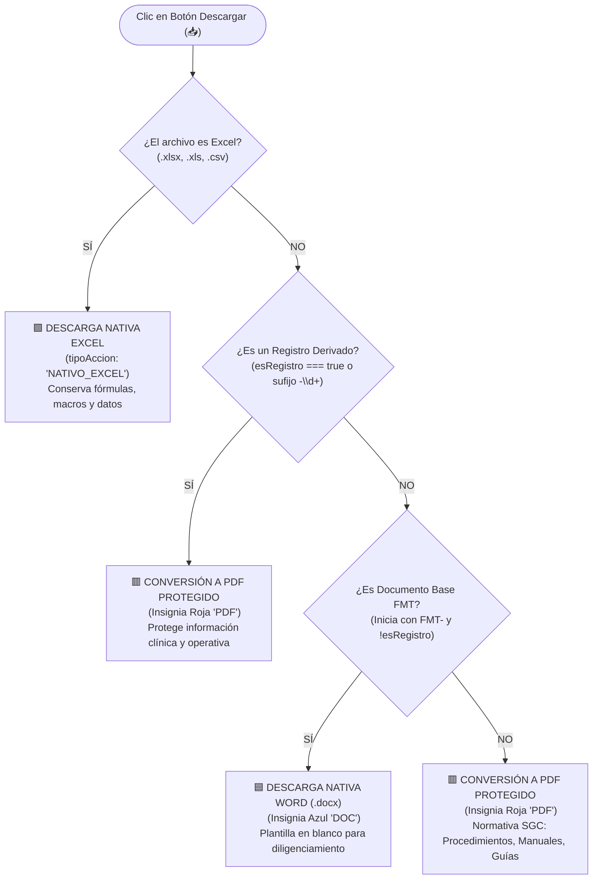

### 6.2. Matriz de Prefijos Oficiales y Formatos de Salida

| Prefijo Oficial | Tipo de Documento Institucional | Formato Base (Padre) | Formato Derivado (Hijo) | Justificación de Calidad |
| :---: | :--- | :---: | :---: | :--- |
| **`FMT-` / `FT-`** | Formato / Plantilla Institucional | **Word (.docx)** | **PDF Protegido** | Plantilla editable; registro diligenciado protegido. |
| **`PRC-` / `PR-`** | Procedimiento Institucional | **PDF Protegido** | **PDF Protegido** | Directriz normativa inalterable. |
| **`INS-` / `IN-`** | Instructivo Técnico | **PDF Protegido** | **PDF Protegido** | Instrucción técnica en solo lectura. |
| **`MN-`** | Manual Organizacional | **PDF Protegido** | **PDF Protegido** | Manual de calidad de consulta inmutable. |
| **`POL-` / `PT-`** | Política Corporativa | **PDF Protegido** | **PDF Protegido** | Política institucional vinculante. |
| **`GUA-` / `GU-`**| Guía Operativa / Práctica Clínica | **PDF Protegido** | **PDF Protegido** | Protocolo asistencial de estricto apego clínico. |
| **`PRG-` / `PG-`**| Programa de Gestión / Salud | **PDF Protegido** | **PDF Protegido** | Documento programático institucional. |
| **`DA-` / `DOC-`** | Documento Anexo | **PDF** (o Excel) | **PDF Protegido** | Soporte técnico o normativo complementario. |
| **`XLSX` / `XLS`** | Cualquier hoja de cálculo | **Excel Nativo** | **Excel Nativo** | Conservación de fórmulas, filtros y macros. |

### 6.3. Matriz de Casos Especiales y Manejo de Extensiones

| Caso Especial / Escenario | Comportamiento del Sistema | Acción en Interfaz de Usuario |
| :--- | :--- | :--- |
| **Caso Canónico `FMT-GIC-016`** | Debe descargar su archivo Word `.docx` original en blanco. **Bajo ninguna circunstancia debe abrir la carpeta de SharePoint**. | Botón `📥 Descargar` sirve archivo Word con insignia azul `DOC`. |
| **Subregistros `FMT-GIC-016-1`, `2`, `3`** | Aunque provienen de un formato `FMT`, contienen datos clínicos diligenciados. **Deben descargarse en PDF protegido**. | Botón `📥 Descargar` invoca conversión PDF y muestra insignia roja `PDF`. |
| **Carpetas de SharePoint (Sin Extensión)** | Las rutas correspondientes a carpetas de SharePoint **jamás deben reemplazar a un archivo descargable**. | El servicio excluye las carpetas del motor de descarga y las asigna exclusivamente al botón `📁 Abrir Carpeta`. |
| **Documentos con Descarga Restringida** | El documento se encuentra catalogado pero protegido contra descargas operativas no autorizadas. | Usuario operativo visualiza `🔒 Bloqueado`. Usuarios autorizados pueden desbloquear mediante Modo Edición. |

---

## 7. Experiencia de Usuario (UI/UX), Modos de Operación y Filtros

### 7.1. Diagrama de Estados: Modo Consulta vs. Modo Edición

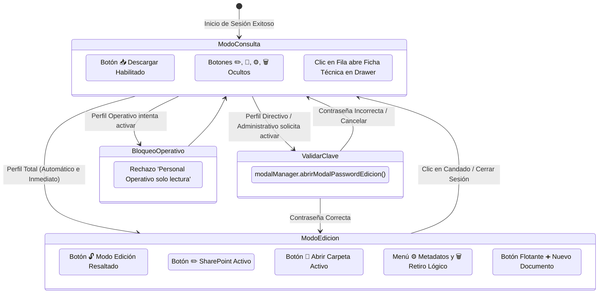

### 7.2. Diagrama de Flujo de Filtros en Cascada y Búsqueda NFD

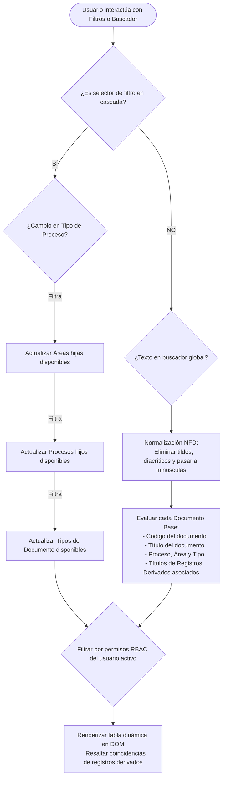

### 7.3. Matriz de Controles de Interfaz según Modo y Perfil

| Elemento de Control | Modo Consulta (`total`) | Modo Consulta (`dir` / `adm`) | Modo Consulta (`operativo`) | Modo Edición Activo (`total` / `dir` / `adm`) |
| :--- | :---: | :---: | :---: | :---: |
| **Botón `📥 Descargar`** | Visible y Activo | Visible y Activo | Visible y Activo | Visible y Activo |
| **Botón `✏️ SharePoint`**| Oculto | Oculto | Oculto | **Visible y Activo** |
| **Botón `📁 Carpeta`** | Oculto | Oculto | Oculto | **Visible y Activo** |
| **Menú `⚙️ Metadatos`** | Oculto | Oculto | Oculto | **Visible** (Solo `total` y `dir`) |
| **Botón `🗑️ Retirar`** | Oculto | Oculto | Oculto | **Visible** (Solo `total` y `dir`) |
| **Botón `➕ Nuevo Doc`** | Oculto | Oculto | Oculto | **Visible** (Solo `total` y `dir`) |
| **Dashboard Analítica**| Visible y Activo | Visible y Activo | **Bloqueada** | Visible y Activo |
| **Gestión de Perfiles** | Visible (Solo `total`)| Oculta | Oculta | Visible (Solo `total`) |

---

## 8. Trazabilidad e Histórico Inmutable de Movimientos

### 8.1. Modelo Oficial de Trazabilidad en Google Sheets (`Historico_Documentos`)

Toda operación que modifique el estado del catálogo documental es auditada de forma inmutable y persistida inmediatamente en la hoja de cálculo **`Historico_Documentos`** de Google Sheets:

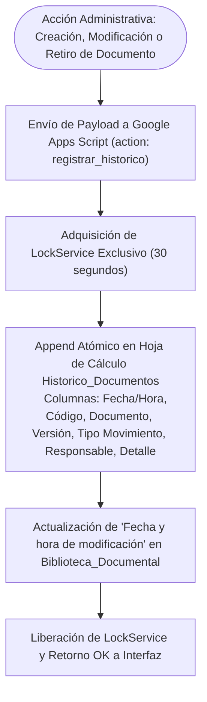

### 8.2. Reglas de Negocio sobre Movimientos y Descargas

1. **Creación, Edición y Retiro:** Generan una nueva fila inmutable en `Historico_Documentos` y actualizan la fecha de modificación (Columna V) en `Biblioteca_Documental`.
2. **Descargas Institucionales:** Cuando un usuario (operativo o administrativo) descarga un documento, se incrementa en $+1$ la columna **Descargas (Columna Y)** del registro en `Biblioteca_Documental`. **Las descargas no alteran la fecha de modificación** del documento ni saturan la hoja de históricos.
3. **Invalidez de Archivos Obsoletos:** Los archivos locales o remotos `Historico_Documentos` e `Historico_Documentos_USV.csv` quedan totalmente eliminados e invalidados, consolidando toda la trazabilidad institucional en Google Sheets.

## 9. Automatización y Flujo de Sincronización en GitHub Actions

### 9.1. Flujo de Comparación y Actualización de Vínculos OneDrive ↔ Biblioteca

El flujo automatizado en GitHub Actions sustituye al antiguo respaldo diario y se encarga del cruce de integridad y reconciliación de enlaces:

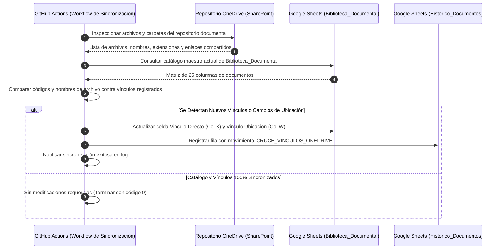

### 9.2. Eliminación de Flujos Obsoletos
- **Retiro del Backup Diario Antiguo:** Se eliminó el flujo anterior de respaldo diario que generaba volcados redundantemente en el repositorio git, mitigando el crecimiento innecesario del histórico de versiones.
- **Enfoque en Disponibilidad Continua:** La sincronización de vínculos asegura que ningún documento en `Biblioteca_Documental` quede huérfano o con enlaces rotos tras traslados o modificaciones en SharePoint/OneDrive.

## 10. Políticas Oficiales de Despliegue, Integración y Seguridad

### 10.1. Integración en SharePoint Online mediante Iframe
La aplicación está diseñada para operar de forma nativa incrustada en páginas de SharePoint Online:
- **Incrustación Segura:** Ejecutada a través del contenedor iframe oficial:
  `<iframe title="Gestión documental" style="width: 100%; height: 100%; border: none;" src="https://unionsaludvida2.github.io/gestiondocumental/" allow="clipboard-write; clipboard-read" allowfullscreen=""></iframe>`
- **Garantía Estricta sin Barras de Desplazamiento Horizontal:** Se prohíbe el uso de scrollbars horizontales en la ventana principal (`overflow-x: hidden`). Todos los contenedores, botones, tablas y tarjetas deben auto-ajustarse al ancho definido por el contenedor de SharePoint.
- **Redimensionamiento Adaptativo:** En pantallas pequeñas o anchos reducidos del iframe, los componentes se redimensionan proporcionalmente (iconos, fuentes, espaciados) y las columnas no críticas de la tabla se ocultan progresivamente para priorizar la visibilidad del documento y sus acciones.

### 10.2. Política de Mínimo Privilegio y Acceso Operativo por Defecto
- Todo usuario que acceda a la página tiene garantizada la consulta inmediata del catálogo vigente.
- La edición de metadatos, borrado y creación de documentos está estrictamente restringida a usuarios con perfil administrativo verificado.
- El perfil administrativo se desbloquea con el candado 🔒 y permanece en la caché del navegador del usuario sin requerir reautenticación continua.

### 10.3. Prohibición de Borrado Físico y Retiro Lógico (Soft-Delete)
Queda estrictamente prohibido eliminar filas físicas en `Biblioteca_Documental`. Todo retiro se efectúa cambiando la columna *Disponibilidad* a `NO DISPONIBLE` o *Estado Actual* a `Retirado`, conservando la fila y auditando el evento en `Historico_Documentos`.

## 11. Decálogo de Gobernanza para Desarrolladores

### 11.1. Tabla Maestra de Mandamientos Técnicos y Sanción por Violación

| # | Mandamiento Técnico | Justificación Técnica | Módulos Afectados | Sanción por Incumplimiento |
| :-: | :--- | :--- | :--- | :--- |
| **1** | **FORMATO SUBREGISTROS:** Ningún derivado en Word. Todos en PDF protegido (salvo `.xlsx`). | Protección de datos clínicos diligenciados. | `sharepoint-service`, `modal` | Sanción de Calidad: Fuga de datos editables. |
| **2** | **CANÓNICO FMT-GIC-016:** Documento base descarga `.docx` en blanco. Jamás abre carpeta. | Plantilla maestra para diligenciamiento. | `sharepoint-service`, `app` | Error UX: Apertura indebida de carpeta. |
| **3** | **RESTRICCIÓN OPERATIVO:** Perfil Operativo jamás accede a botones de edición ni Dashboard. | Mínimo Privilegio y segregación de funciones. | `modal.js`, `analytics.js` | Brecha Seguridad: Alteración no autorizada. |
| **4** | **HASH DE CONTRASEÑAS:** Toda contraseña en `usuarios.conf` se hashea con SHA-256. | Protección criptográfica de credenciales. | `staff-service.js`, GAS | Brecha Crítica: Compromiso de contraseñas. |
| **5** | **BLOQUEO COM WORD:** `server.py` mantiene exclusión mutua `WORD_CONVERT_LOCK`. | Word COM no es thread-safe en Windows. | `server.py` | Fallo de Sistema: Cuelgue de `WINWORD.EXE`. |
| **6** | **DEFAULT DENY EN SHEETS:** Celdas vacías = `false`. Solo `'X'` otorga permiso explícito. | Mínimo Privilegio. Evita fuga de documentos. | `filters.js`, Apps Script | Brecha Privacidad: Acceso no autorizado. |
| **7** | **PROHIBICIÓN BORRADO FÍSICO:** Prohibida purga de filas. Todo retiro es *Soft-Delete*. | Inmutabilidad y trazabilidad legal SGC. | `modal.js`, Apps Script | Violación Legal: Pérdida de histórico. |
| **8** | **TASA LÍMITE Y BLOQUEO:** 3 fallos = 15 min; 3 bloqueos = permanente; desbloqueo Superadmin. | Prevención de ataques de fuerza bruta. | `staff-service.js`, `modal` | Vulnerabilidad: Exposición de cuentas. |
| **9** | **AUTENTICACIÓN LOCAL:** Modelo Local Oficial con SSO de navegador. `auth.js` eliminado. | Autonomía técnica ante bloqueos de Azure. | `staff-service.js`, `index` | Inestabilidad: Errores de token en Azure. |
| **10**| **RESOLUCIÓN DUAL:** Registros derivados se resuelven por `r.id === id \|\| r.codigo === id`. | Consistencia en el DOM ante nombres dispares. | `app.js`, `modal.js` | Error Funcional: Drawer/botones no responden. |

### 11.2. Resumen Nemotécnico para el Desarrollador

```
================================================================================
           DECÁLOGO DE GOBERNANZA TÉCNICA Y ARQUITECTÓNICA (SSOT)
================================================================================
1. FORMATO DE SUBREGISTROS:
   NINGÚN registro derivado debe descargarse en Word.
   TODOS los registros derivados deben descargarse en PDF protegido (insignia roja PDF),
   a menos que sean hojas de cálculo (.xlsx).

2. CASO CANÓNICO FMT-GIC-016:
   El documento base FMT-GIC-016 DEBE descargar su archivo .docx original.
   NO DEBE abrir la carpeta de SharePoint.

3. RESTRICCIÓN OPERATIVA:
   El perfil Operativo JAMÁS debe tener acceso a botones de edición ni al Dashboard.

4. CRIPTOGRAFÍA DE CONTRASEÑAS:
   Las contraseñas en usuarios.conf SIEMPRE se hashean en SHA-256 antes de guardarse.

5. BLOQUEO COM EN CONVERSIÓN:
   El servidor local server.py debe mantener activo el bloqueo WORD_CONVERT_LOCK
   en toda conversión para garantizar estabilidad en Windows.

6. PERMISOS EN GOOGLE SHEETS (DEFAULT DENY):
   Columnas en blanco en Directivo, Administrativo u Operativo = DENEGACIÓN POR DEFECTO.
   Únicamente la presencia explícita de 'X' concede permiso de visualización o edición.

7. PROHIBICIÓN DE BORRADO FÍSICO (SOFT-DELETE):
   Queda estrictamente PROHIBIDO el borrado físico de filas en Google Sheets.
   Todo retiro debe ser un retiro lógico (Soft-Delete) a 'Eliminado' u 'Obsoleto'.

8. TASA LÍMITE Y BLOQUEO ESCALONADO:
   3 intentos fallidos = 15 minutos de bloqueo temporal.
   3 bloqueos temporales consecutivos = Bloqueo permanente de cuenta.
   Desbloqueo condicionado exclusivamente a Superadministradores (Acceso Total).

9. ARQUITECTURA DE AUTENTICACIÓN OFICIAL:
   Modelo Oficial (staff-service.js contra usuarios.conf y staff-data.js)
   con SSO federado por navegador hacia SharePoint. El componente legado auth.js
   queda formalmente dado de baja y eliminado.

10. RESOLUCIÓN DUAL DE SUBREGISTROS:
    Todo registro derivado DEBE tener un ID canónico y resolverse mediante búsqueda
    dual (r.id === regId || r.codigo === regId) para garantizar funcionalidad en el DOM.
================================================================================
```

---

## 12. Reglas de Negocio del Dashboard y Analítica Institucional

### 12.1. Arquitectura de Módulos del Dashboard y Matriz de Acceso RBAC

El subsistema de Dashboard y Analítica Institucional está estructurado como una estación de mando integral en la barra lateral (`sidebar-dashboard-nav-content`) compuesta por **cuatro módulos operacionales especializados** y un **grupo centralizado de exportaciones corporativas**.

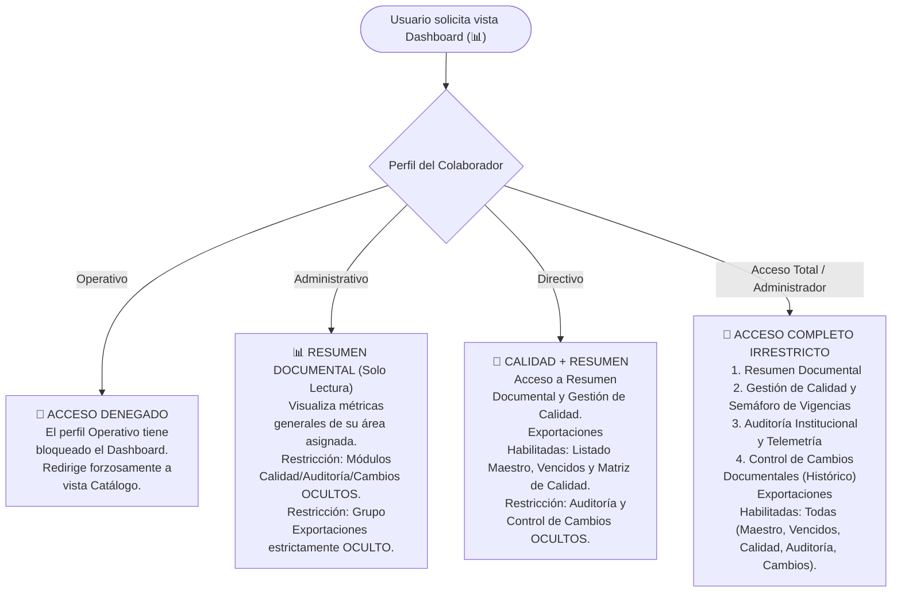

#### Matriz de Capacidades y Visibilidad en los Módulos del Dashboard

| Módulo del Dashboard | Perfil Operativo | Perfil Administrativo | Perfil Directivo | Perfil Acceso Total (`total`) |
| :--- | :---: | :---: | :---: | :---: |
| **Resumen Documental (`resumen`)** | 🚫 Bloqueado | 👁️ Solo Lectura (Filtrado) | 👁️ Completo | 👁️ Completo (SSOT) |
| **Gestión de Calidad (`calidad`)** | 🚫 Bloqueado | 🚫 Bloqueado | 👁️ Completo | 👁️ Completo (SSOT) |
| **Auditoría Institucional (`auditoria`)** | 🚫 Bloqueado | 🚫 Bloqueado | 🚫 Bloqueado | 👁️ Completo (SSOT) |
| **Control de Cambios (`cambios`)** | 🚫 Bloqueado | 🚫 Bloqueado | 🚫 Bloqueado | 👁️ Completo (SSOT) |
| **Exportar Listado Maestro (`.csv`)** | 🚫 Bloqueado | 🚫 Bloqueado | ✅ Permitido | ✅ Permitido |
| **Exportar Documentos Vencidos (`.csv`)** | 🚫 Bloqueado | 🚫 Bloqueado | ✅ Permitido | ✅ Permitido |
| **Exportar Matriz de Calidad (`.csv`)** | 🚫 Bloqueado | 🚫 Bloqueado | ✅ Permitido | ✅ Permitido |
| **Exportar Auditoría de Accesos (`.csv`)** | 🚫 Bloqueado | 🚫 Bloqueado | 🚫 Bloqueado | ✅ Permitido |
| **Exportar Control de Cambios (`.csv`)** | 🚫 Bloqueado | 🚫 Bloqueado | 🚫 Bloqueado | ✅ Permitido |

---

### 12.2. Políticas de Gestión de Calidad y Semáforo Quinquenal de Vigencias

#### 12.2.1. Modelo Matemático y Algoritmo de Evaluación de Vigencia (`evaluarVigenciaDoc`)

La vigencia de cada documento institucional se rige por un motor de cálculo determinístico que evalúa fechas normativas en milisegundos bajo la hora cero local:

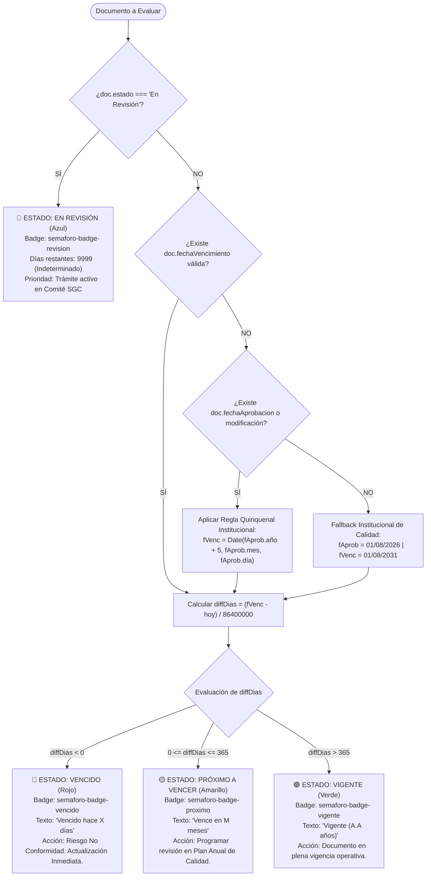

#### 12.2.2. Semáforo Normativo Quinquenal Institucional

| Estado del Semáforo | Código Hex / Color | Umbral Cronológico | Etiqueta UI | Impacto SGC y Conducta Requerida |
| :--- | :---: | :---: | :---: | :--- |
| **`REVISION`** | `#0284c7` (Azul) | Estado = `En Revisión` | `En Revisión` | Documento en mesa técnica de modificación; se permite consulta de la versión anterior vigente. |
| **`VENCIDO`** | `#dc2626` (Rojo) | $\Delta_{\text{días}} < 0$ | `Vencido (X d)` | **Alerta Crítica:** Documento expirado. Requiere aprobación o ratificación urgente por la Dirección de Calidad. |
| **`PROXIMO`** | `#b45309` (Ámbar) | $0 \le \Delta_{\text{días}} \le 365$ | `Vence en M m` | **Alerta Preventiva:** Vence dentro de los próximos 12 meses. Se incluye en el cronograma de revisión SGC. |
| **`VIGENTE`** | `#15803d` (Verde) | $\Delta_{\text{días}} > 365$ | `Vigente (A a)` | **Conforme:** Documento con más de un año de vigencia normativa restante. |

#### 12.2.3. Disponibilidad Técnica y Salud Global Documental

1. **Condición de Disponibilidad Técnica:** Un documento se clasifica como técnicamente disponible en la matriz de calidad si y solo si:
   $$\text{esDisponible} \iff (d.\text{disponible} === \text{true}) \land (d.\text{sharepointUrl} \ne '') \land (d.\text{sharepointUrl} \ne \text{'#'})$$
   Cualquier documento con URL rota, vacía o con bandera `disponible === false` se contabiliza como **No Disponible** y alimenta el reporte de alertas de calidad.
2. **Fórmula del Índice de Salud Global Documental:**
   $$\text{Salud Global SGC (\%)} = \text{round}\left( \frac{\text{Documentos Vigentes} + \text{Documentos en Revisión}}{\text{Total Documentos en Catálogo}} \times 100 \right)$$
   Un índice inferior al **90%** dispara advertencia de gobernanza en la ficha ejecutiva del Dashboard.

#### 12.2.4. Cascada de Filtros Multidimensional Normalizada NFD

Para garantizar que los auditores encuentren documentos sin discrepancias ortográficas, el módulo de calidad implementa una cascada reactiva de 4 niveles gobernada por normalización NFD (descomposición canónica sin diacríticos):
1. **Nivel 1 (Macroproceso / Tipo de Proceso):** Extraído de `tipoProceso` o `macroproceso` (`Misional`, `Estratégico`, `Apoyo`, `Evaluación`).
2. **Nivel 2 (Área Institucional):** Filtrado dinámicamente según el Macroproceso seleccionado. Mapea siglas oficiales:
   - `GTH` $\rightarrow$ Talento Humano / Seguridad y Salud en el Trabajo.
   - `GTI` $\rightarrow$ Tecnología e Información / TIC.
   - `GAD` $\rightarrow$ Administrativa / Servicios Generales.
   - `GFI` $\rightarrow$ Financiera / Facturación / Cartera.
   - `GIC` $\rightarrow$ Gestión Integral de Calidad.
   - `GMD` $\rightarrow$ Dirección Médica / Asistencial / Farmacéutica.
3. **Nivel 3 (Proceso Específico):** Filtrado dependiente del Área seleccionada.
4. **Nivel 4 (Tipo de Documento):** Catálogo de tipos disponibles según el subconjunto filtrado.

---

### 12.3. Políticas de Auditoría Institucional y Trazabilidad Transaccional

#### 12.3.1. Principio de No-Repudio y Registro Inmutable

Toda interacción de usuario que modifique datos, descargue archivos, acceda a directorios estructurados o altere la seguridad queda registrada con sello de tiempo inmutable en el archivo de Google Drive `Historico_Documentos` y en la caché del navegador cliente.

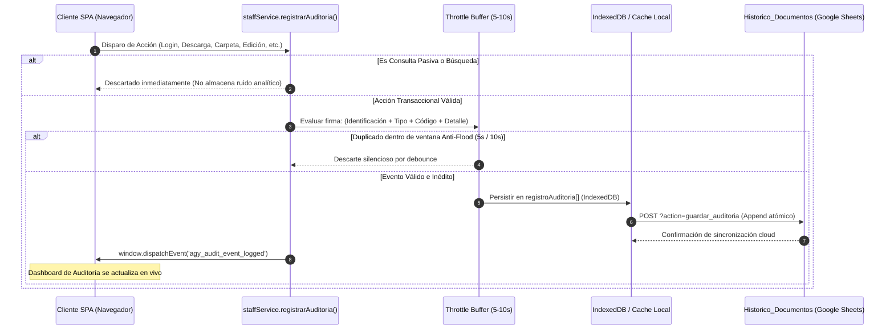

#### 12.3.2. Catálogo Oficial de Eventos de Auditoría Transaccional

| Evento | Origen del Disparo | Ventana Anti-Flood | Atributos Registrados Obligatorios | Regla de Negocio / Propósito |
| :---: | :--- | :---: | :--- | :--- |
| **`LOGIN`** | Autenticación exitosa en `staff-service.js`. | 10 segundos | Cédula, Nombre, Cargo, Perfil, Dispositivo, Timestamp. | Control de acceso no-repudiable. |
| **`DESCARGA`** | Clic en botón `📥` de tabla o drawer. | 5 segundos | Código, Título, Extensión, Subclase, Formato Servido. | Auditoría de consumo documental y fuga. |
| **`CARPETA`** | Clic en botón `📁 Carpeta SharePoint`. | 5 segundos | Código, Carpeta Destino, Usuario, Perfil. | Trazabilidad de navegación en SharePoint. |
| **`EDICION`** | Clic en botón `✏️ SharePoint`. | 5 segundos | Código, Título, Colaborador, URL SharePoint. | Trazabilidad de edición física. **Bloqueado para operativos.** |
| **`CREACION`** | Alta de documento en modal o sincro. | Inmediato | Código, Título, Subclase, Código Padre, Autor. | Integridad en la creación de versiones iniciales. |
| **`METADATOS`**| Edición en modal o sincronización. | Inmediato | Código, Campos Modificados, Autor, Cédula. | Trazabilidad del cambio de fichas técnicas. |
| **`ELIMINACION`**| Retiro lógico o exclusión del catálogo. | Inmediato | Código, Motivo Obligatorio, Gestor de Calidad. | Justificación legal de obsolescencia. |
| **`SEGURIDAD`** | Alta de usuario, clave o desbloqueo. | Inmediato | Cédula afectada, Acción de seguridad, Autor. | Auditoría de administración de identidades. |

#### 12.3.3. Monitoreo en Vivo y Sincronización Automática
- **Polling de Fondo Activo:** Cuando el administrador se encuentra dentro de la pestaña `auditoria`, el cliente ejecuta una sincronización automática en vivo cada **15 segundos** (`_intervaloAuditoriaAutoSync`) para capturar eventos de otros usuarios en la institución.
- **Sincronización por Foco:** Al regresar a la pestaña del navegador (`window.focus` o `visibilitychange`), se ejecuta inmediatamente `sincronizarAuditoria(true)`.
- **Botón Manual:** La interfaz dispone del botón `🔄 Sincronizar ahora` con animación de giro para comprobación inmediata bajo demanda.

---

### 12.4. Políticas de Control de Cambios Documentales (Histórico Oficial)

#### 12.4.1. Repositorio Oficial `Historico_Documentos` (Google Sheets)

La hoja de cálculo de Google Sheets `Historico_Documentos` constituye la **Fuente Única de Verdad Histórica** del ciclo de vida de los documentos de Unión para la salud y la vida S.A.S. No puede ser purgada ni reescrita de forma destructiva; opera exclusivamente bajo el modelo de incorporación secuencial (*append-only*).

#### 12.4.2. Algoritmo de Detección de Cambios por Snapshot Diferencial

En cada ciclo de inicio o actualización del catálogo maestro, el motor `detectarCambiosDocumentales()` compara el estado actual contra la instantánea persistida (`snapshotAnterior`):

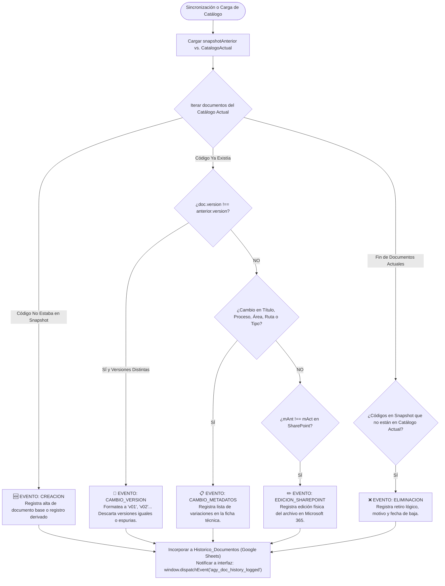

#### 12.4.3. Reglas de Validación y Saneamiento Estricto de Versiones
1. **Formato Canónico Tripartito:** Toda versión se normaliza estrictamente al patrón `v` + 2 dígitos (`v01`, `v02`, ..., `v10`).
2. **Descarte de Falsos Cambios:** Si al normalizar la versión anterior y la nueva resultan idénticas (`staffService.sonVersionesIguales(vA, vN)`), el evento se descarta por redundante.
3. **Filtro de Contenido Espurio:** Se descartan eventos históricos que contengan versiones mayores a 8 caracteres o que contengan texto arbitrario proveniente de columnas desplazadas en hojas de cálculo.

#### 12.4.4. Detección y Trazabilidad de Registros Derivados (Subregistros)
- Todo registro que cumpla la expresión regular `^([A-Za-z0-9]+-[A-Za-z0-9]+-\d+)-(\d+)$` o posea la propiedad `esRegistro: true` se etiqueta automáticamente con la insignia `📂 Registro Derivado`.
- Se asocia obligatoriamente a su documento padre en el histórico mediante `documentoPadreCodigo`.
- La interfaz de Control de Cambios cuenta con el botón de filtrado exclusivo `📂 Registros Derivados` para fiscalizar auditorías asistenciales independientes de las directrices maestras.

---

### 12.5. Políticas de Exportaciones Oficiales e Interoperabilidad (CSV / Excel)

#### 12.5.1. Catálogo Oficial de Reportes Exportables del Dashboard

| Reporte Exportable | Módulo Origen | Archivo Generado | Columnas | Cobertura y Utilidad SGC |
| :--- | :--- | :--- | :---: | :--- |
| **Listado Maestro de Documentos** | Resumen Documental | `Listado_Maestro_Documentos_USV_YYYY-MM-DD.csv` | 18 | Inventario total del SGC con metadatos, versiones, permisos RBAC y rutas SharePoint. |
| **Documentos Vencidos o No Disponibles** | Resumen Documental | `DOCUMENTOS_VENCIDOS_USV_YYYY-MM-DD.csv` | 13 | Documentos vencidos normativamente, $> 2$ años sin actualización o sin URL funcional. |
| **Matriz de Calidad y Vigencias** | Gestión de Calidad | `Matriz_Calidad_y_Vigencias_USV_YYYY-MM-DD.csv` | 16 | Diagnóstico semafórico, días restantes de vigencia, tiempos de retención y custodia. |
| **Auditoría de Actividad y Accesos** | Auditoría Institucional | `Auditoria_Actividad_USV_YYYY-MM-DD.csv` | 13 | Log forense de ingresos, descargas de documentos, accesos a carpetas y seguridad. |
| **Control de Cambios Documentales** | Control de Cambios | `CONTROL_CAMBIOS_DOCUMENTALES_USV_YYYY-MM-DD.csv` | 16 | Trazabilidad del ciclo de vida: creaciones, versiones, traslados y eliminaciones. |

#### 12.5.2. Estándar Técnico de Exportación Universal
Para asegurar total compatibilidad con Microsoft Excel en entornos hispanohablantes (configuración regional de Colombia y Latinoamérica) sin provocar alteraciones de codificación:
1. **Preámbulo UTF-8 con BOM (`\uFEFF`):** Es de inclusión obligatoria al inicio del contenido exportado para evitar la distorsión de caracteres con tildes, diéresis o eñes en Excel.
2. **Delimitador Estándar:** Punto y coma (`;`). Está prohibido utilizar coma (`,`) debido a colisiones con nombres de procesos y decimales en el estándar regional.
3. **Encapsulación de Texto:** Todo campo alfanumérico se encierra entre comillas dobles (`"valor"`), y cualquier comilla interna se escapa duplicándola (`""`).
4. **Final de Línea:** Retorno de carro y salto de línea (`\r\n` - CRLF estándar Windows).

